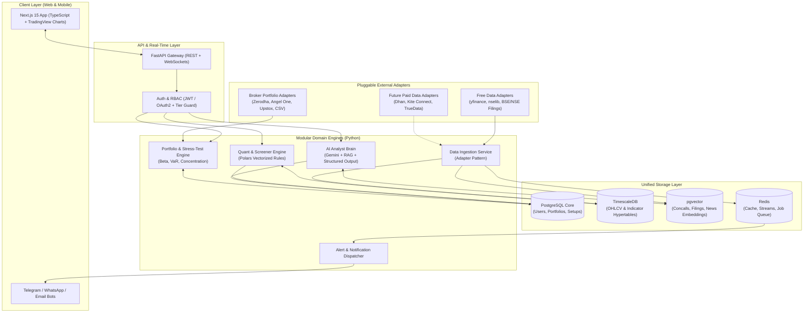
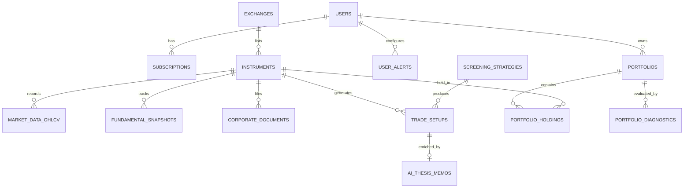

# System Architecture & Extensible Database Schema Design
## AI-Powered Swing Screener & Portfolio Intelligence Platform

---

## 1. Architectural Philosophy: "Plug-and-Play Extensibility"

To ensure **future expansion across all fields** without rewriting core logic, the platform follows a **Modular Hexagonal Architecture (Ports & Adapters)** combined with an **Event-Driven Pipeline**:

1. **Market & Asset Agnostic Core**: Although launching with **NSE/BSE Equities**, the core domain models (`Instrument`, `Exchange`, `MarketDataBar`) natively support **US Equities, F&O (Options/Futures), Commodities, Mutual Funds, ETFs, and Crypto**.
2. **Pluggable Data Provider Adapter**: Starts with **100% Free Providers** (`yfinance`, `nselib` Bhavcopy, NSE/BSE Corporate RSS feeds) behind a standardized `MarketDataProvider` interface. Upgrading to **Zerodha Kite, Dhan API, or TrueData** requires only adding a new adapter class.
3. **Hybrid Database Engine (Single PostgreSQL Cluster)**: Uses **PostgreSQL 16+** enhanced with two extensions:
   - **TimescaleDB**: High-performance time-series storage for OHLCV candles and precomputed indicators.
   - **pgvector**: Vector embeddings for RAG over earnings concalls, annual reports, and exchange filings.
   - **JSONB Dynamic Attributes**: Allows adding new asset-specific metadata, custom strategy parameters, or new AI dimensions without destructive `ALTER TABLE` migrations.

---

## 2. Recommended Best-in-Class Tech Stack

| Layer | Technology | Why It Is the Best Choice |
| :--- | :--- | :--- |
| **Frontend Web App** | **Next.js 15 (App Router) + TypeScript** | SSR for SEO, ultra-fast dashboard routing, type safety across client/server. |
| **UI & Charting** | **Tailwind CSS + shadcn/ui + TradingView Lightweight Charts** | Institutional-grade financial charting with custom Entry/SL/Target overlay lines. |
| **Backend & Quant Engine** | **Python 3.12 + FastAPI + Polars + pandas-ta** | Python is the undisputed standard for quantitative analysis, vector math, and AI orchestration; **Polars** processes 500+ stocks' history 10x faster than Pandas. |
| **Primary Database** | **PostgreSQL + TimescaleDB + pgvector** | Unifies relational SaaS data, high-speed time-series candles, and AI vector search in one ACID-compliant engine. |
| **Cache & Event Bus** | **Redis 7 (Streams + Cache)** | Powers real-time price caches, background job queues, and WebSocket alerts. |
| **Task Orchestration** | **Celery Beat / Arq (Async Redis Queue)** | Schedules EOD Bhavcopy ingestion, intraday 15-min scans, and concall parsing. |
| **AI Brain Engine** | **Google Gemini API (`google-genai` SDK)** | Long context window (1M+ tokens for full concall PDFs), native structured outputs (Pydantic), and low-cost high-speed reasoning. |
| **Free Data Sources (MVP)** | **`yfinance` + `nselib` + BSE/NSE Public Feeds** | Zero data licensing cost for MVP; provides 15-min/EOD OHLCV, NSE Delivery %, FII/DII data, and corporate filing PDFs. |

---

## 3. High-Level System Architecture



---

## 4. Pluggable Adapter Design (Future-Proofing Code Pattern)

By abstracting data ingestion, broker synchronization, and strategy evaluation behind strict interfaces, adding a new market, data vendor, or asset class never breaks existing code:

```
backend/
├── adapters/
│   ├── market_data/
│   │   ├── base.py              # Abstract MarketDataProvider interface
│   │   ├── yfinance_adapter.py  # Free OHLCV & Fundamentals (Active MVP)
│   │   ├── nselib_adapter.py    # Free NSE Delivery %, Bhavcopy, Indices (Active MVP)
│   │   ├── bse_filings.py       # Free Corporate Announcements & Concall PDFs (Active MVP)
│   │   └── truedata_adapter.py  # Future real-time WebSocket tick feed (Plug-in)
│   ├── brokers/
│   │   ├── base.py              # Abstract BrokerPortfolioAdapter interface
│   │   ├── csv_adapter.py       # Universal CSV/Excel importer (Active MVP)
│   │   ├── zerodha_adapter.py   # Kite Connect OAuth holdings sync
│   │   └── angelone_adapter.py  # SmartAPI OAuth holdings sync
│   └── ai_providers/
│       ├── base.py              # Abstract LLM Research Agent interface
│       └── gemini_agent.py      # Google Gemini Structured Concall & Thesis Agent
```

---

## 5. Extensible Database Schema Design (PostgreSQL + TimescaleDB + pgvector)

### 5.1 Entity-Relationship Overview



---

### 5.2 Core DDL Schema Definitions

#### Domain 1: Multi-Market & Multi-Asset Instrument Registry
*Designed so you can expand from NSE/BSE Equities to US Stocks, Options, Futures, ETFs, or Crypto seamlessly.*

```sql
-- Enable required extensions
CREATE EXTENSION IF NOT EXISTS "uuid-ossp";
CREATE EXTENSION IF NOT EXISTS "timescaledb";
CREATE EXTENSION IF NOT EXISTS "vector";

CREATE TABLE exchanges (
    id VARCHAR(20) PRIMARY KEY,              -- e.g., 'NSE', 'BSE', 'NASDAQ', 'NYSE', 'NFO'
    name VARCHAR(100) NOT NULL,
    country_code CHAR(2) NOT NULL,           -- 'IN', 'US'
    currency VARCHAR(10) NOT NULL,           -- 'INR', 'USD'
    timezone VARCHAR(50) NOT NULL,           -- 'Asia/Kolkata', 'America/New_York'
    trading_hours JSONB NOT NULL,            -- {"open": "09:15", "close": "15:30", "days": [1,2,3,4,5]}
    is_active BOOLEAN DEFAULT TRUE
);

CREATE TABLE instruments (
    id UUID PRIMARY KEY DEFAULT uuid_generate_v4(),
    exchange_id VARCHAR(20) REFERENCES exchanges(id),
    symbol VARCHAR(50) NOT NULL,             -- e.g., 'RELIANCE', 'TRENT'
    isin VARCHAR(20),                        -- 'INE002A01018'
    name VARCHAR(255) NOT NULL,
    asset_class VARCHAR(30) NOT NULL,        -- 'EQUITY', 'INDEX', 'ETF', 'OPTION', 'FUTURE', 'CRYPTO'
    sector VARCHAR(100),
    industry VARCHAR(100),
    market_cap_category VARCHAR(30),         -- 'LARGE_CAP', 'MID_CAP', 'SMALL_CAP'
    lot_size INT DEFAULT 1,
    tick_size NUMERIC(10, 4) DEFAULT 0.05,
    provider_mappings JSONB DEFAULT '{}',    -- {"yfinance": "RELIANCE.NS", "zerodha": "738561", "bse": "500325"}
    extended_metadata JSONB DEFAULT '{}',    -- Future-proof: Option strike/expiry, F&O ban status, Nifty500 constituent flag
    is_active BOOLEAN DEFAULT TRUE,
    created_at TIMESTAMPTZ DEFAULT NOW(),
    UNIQUE(exchange_id, symbol)
);

CREATE INDEX idx_instruments_sector ON instruments(sector);
CREATE INDEX idx_instruments_asset_class ON instruments(asset_class);
CREATE INDEX idx_instruments_provider_mappings ON instruments USING GIN (provider_mappings);
```

---

#### Domain 2: Time-Series Market Data & Indicator Store (TimescaleDB)
*Supports any timeframe (`1m`, `5m`, `15m`, `1h`, `1d`, `1w`) and stores precomputed technical indicators in an extensible `JSONB` column alongside core columns for instant screening.*

```sql
CREATE TABLE market_data_ohlcv (
    time TIMESTAMPTZ NOT NULL,
    instrument_id UUID NOT NULL REFERENCES instruments(id) ON DELETE CASCADE,
    timeframe VARCHAR(10) NOT NULL,          -- '15m', '1h', '1d', '1w'
    open NUMERIC(18, 4) NOT NULL,
    high NUMERIC(18, 4) NOT NULL,
    low NUMERIC(18, 4) NOT NULL,
    close NUMERIC(18, 4) NOT NULL,
    volume BIGINT NOT NULL,
    delivery_volume BIGINT,                  -- Specific to NSE/BSE swing accumulation analysis
    delivery_percentage NUMERIC(6, 2),
    vwap NUMERIC(18, 4),
    -- Core precomputed indicators for fast SQL/Polars filtering
    ema_20 NUMERIC(18, 4),
    sma_50 NUMERIC(18, 4),
    sma_200 NUMERIC(18, 4),
    rsi_14 NUMERIC(6, 2),
    atr_14 NUMERIC(18, 4),
    rel_volume_20d NUMERIC(8, 2),            -- Current volume / 20-day avg volume
    -- Extensible JSONB for future custom indicators (MACD, Bollinger, SuperTrend, VCP contraction %)
    custom_indicators JSONB DEFAULT '{}',
    PRIMARY KEY (time, instrument_id, timeframe)
);

-- Convert into a TimescaleDB Hypertable partitioned by time
SELECT create_hypertable('market_data_ohlcv', 'time');
CREATE INDEX idx_ohlcv_instrument_tf ON market_data_ohlcv(instrument_id, timeframe, time DESC);

CREATE TABLE fundamental_snapshots (
    id UUID PRIMARY KEY DEFAULT uuid_generate_v4(),
    instrument_id UUID NOT NULL REFERENCES instruments(id) ON DELETE CASCADE,
    period_end_date DATE NOT NULL,           -- Quarter end date
    market_cap_cr NUMERIC(18, 2),
    pe_ratio NUMERIC(10, 2),
    roe_pct NUMERIC(8, 2),
    roce_pct NUMERIC(8, 2),
    debt_to_equity NUMERIC(8, 2),
    sales_growth_yoy NUMERIC(8, 2),
    profit_growth_yoy NUMERIC(8, 2),
    promoter_holding_pct NUMERIC(6, 2),
    promoter_pledge_pct NUMERIC(6, 2),
    fii_holding_pct NUMERIC(6, 2),
    dii_holding_pct NUMERIC(6, 2),
    -- Future-proof for sector-specific ratios (CASA, NIM for banks, EV/EBITDA, Order Book)
    extra_ratios JSONB DEFAULT '{}',
    updated_at TIMESTAMPTZ DEFAULT NOW(),
    UNIQUE(instrument_id, period_end_date)
);
```

---

#### Domain 3: Screener Strategies & Actionable Trade Setup Cards
*Separates the **Strategy Definition** (versioned rules/code) from the generated **Trade Setup Cards**, enabling future custom user strategies and full historical backtesting.*

```sql
CREATE TABLE screening_strategies (
    id UUID PRIMARY KEY DEFAULT uuid_generate_v4(),
    slug VARCHAR(100) UNIQUE NOT NULL,       -- e.g., 'vcp-delivery-breakout', 'stage-2-earnings-leader'
    name VARCHAR(150) NOT NULL,
    category VARCHAR(50) NOT NULL,           -- 'SWING', 'POSITIONAL', 'MOMENTUM', 'MEAN_REVERSION'
    holding_period_days INT4RANGE,           -- e.g., [5, 30] days
    rule_definition JSONB NOT NULL,          -- Declarative filter AST or Python plugin reference
    risk_model_config JSONB NOT NULL,        -- Stop-loss ATR multiplier, target R:R ratios
    is_system_strategy BOOLEAN DEFAULT TRUE,
    created_by UUID,                         -- NULL for system, or user_id for custom user strategies
    version INT DEFAULT 1,
    is_active BOOLEAN DEFAULT TRUE
);

CREATE TABLE trade_setups (
    id UUID PRIMARY KEY DEFAULT uuid_generate_v4(),
    instrument_id UUID NOT NULL REFERENCES instruments(id),
    strategy_id UUID NOT NULL REFERENCES screening_strategies(id),
    detected_at TIMESTAMPTZ NOT NULL DEFAULT NOW(),
    timeframe VARCHAR(10) NOT NULL DEFAULT '1d',
    direction VARCHAR(10) NOT NULL DEFAULT 'LONG', -- 'LONG', 'SHORT' (for future F&O / Intraday)
    status VARCHAR(30) NOT NULL DEFAULT 'ACTIVE',  -- 'ACTIVE', 'TRIGGERED', 'TARGET_1_HIT', 'STOPPED_OUT', 'INVALIDATED', 'EXPIRED'
    
    -- Actionable Price Levels
    trigger_price NUMERIC(18, 4) NOT NULL,
    entry_zone_min NUMERIC(18, 4) NOT NULL,
    entry_zone_max NUMERIC(18, 4) NOT NULL,
    stop_loss_price NUMERIC(18, 4) NOT NULL,
    stop_loss_pct NUMERIC(6, 2) NOT NULL,
    target_1_price NUMERIC(18, 4) NOT NULL,
    target_2_price NUMERIC(18, 4) NOT NULL,
    target_3_price NUMERIC(18, 4),
    risk_reward_ratio NUMERIC(6, 2) NOT NULL,
    
    -- Quantitative Scoring & Checklist
    quant_conviction_score NUMERIC(5, 2),    -- 0 to 100 deterministic score
    setup_checklist JSONB NOT NULL,          -- [{"rule": "Volume > 2x 20DMA", "passed": true}, ...]
    chart_annotations JSONB DEFAULT '{}',    -- Coordinates for resistance line, base depth, etc.
    
    -- Outcome tracking (for automated strategy win-rate audit)
    outcome_return_pct NUMERIC(8, 2),
    closed_at TIMESTAMPTZ
);

CREATE INDEX idx_trade_setups_status_date ON trade_setups(status, detected_at DESC);
CREATE INDEX idx_trade_setups_instrument ON trade_setups(instrument_id, detected_at DESC);
```

---

#### Domain 4: The AI "Brain" (RAG Knowledge Base & Second-Opinion Memos)
*Stores chunked embeddings of concalls, filings, and news in `pgvector` and links structured AI memos to stocks and trade setups.*

```sql
CREATE TABLE corporate_documents (
    id UUID PRIMARY KEY DEFAULT uuid_generate_v4(),
    instrument_id UUID NOT NULL REFERENCES instruments(id) ON DELETE CASCADE,
    doc_type VARCHAR(50) NOT NULL,           -- 'CONCALL_TRANSCRIPT', 'EARNINGS_RELEASE', 'BSE_ANNOUNCEMENT', 'NEWS'
    title TEXT NOT NULL,
    published_at TIMESTAMPTZ NOT NULL,
    source_url TEXT,
    raw_text TEXT,
    metadata JSONB DEFAULT '{}'              -- Quarter, FY, speaker names, filing category
);

CREATE TABLE document_embeddings (
    id UUID PRIMARY KEY DEFAULT uuid_generate_v4(),
    document_id UUID NOT NULL REFERENCES corporate_documents(id) ON DELETE CASCADE,
    instrument_id UUID NOT NULL REFERENCES instruments(id) ON DELETE CASCADE,
    chunk_index INT NOT NULL,
    chunk_text TEXT NOT NULL,
    embedding VECTOR(768),                   -- Compatible with gemini-embedding-001 / gemini-embedding-2
    metadata JSONB DEFAULT '{}'
);

CREATE INDEX idx_doc_embeddings_vec ON document_embeddings USING hnsw (embedding vector_cosine_ops);

CREATE TABLE ai_thesis_memos (
    id UUID PRIMARY KEY DEFAULT uuid_generate_v4(),
    instrument_id UUID NOT NULL REFERENCES instruments(id),
    trade_setup_id UUID REFERENCES trade_setups(id) ON DELETE SET NULL,
    generated_at TIMESTAMPTZ DEFAULT NOW(),
    model_used VARCHAR(100) NOT NULL,        -- e.g., 'gemini-3.8-flash'
    
    -- Structured Output Fields
    verdict VARCHAR(30) NOT NULL,            -- 'STRONG_ALIGNMENT', 'MODERATE_ALIGNMENT', 'NEUTRAL', 'CAUTION_CONFLICT'
    ai_conviction_score INT CHECK (ai_conviction_score BETWEEN 0 AND 100),
    executive_summary TEXT NOT NULL,
    concall_highlights JSONB NOT NULL,       -- Bullet points on guidance, capex, order book
    sector_tailwinds JSONB NOT NULL,         -- Macro/policy catalysts
    red_flags_and_risks JSONB NOT NULL,      -- Governance, margin pressure, pledges
    citations JSONB DEFAULT '[]',            -- Links back to corporate_documents IDs
    
    expires_at TIMESTAMPTZ                   -- Cache TTL until next filing/price shift
);
```

---

#### Domain 5: Users, SaaS Billing, Portfolios & Stress Testing

```sql
CREATE TABLE users (
    id UUID PRIMARY KEY DEFAULT uuid_generate_v4(),
    email VARCHAR(255) UNIQUE NOT NULL,
    full_name VARCHAR(150),
    password_hash TEXT,
    subscription_tier VARCHAR(30) DEFAULT 'FREE', -- 'FREE', 'PRO', 'ELITE'
    preferences JSONB DEFAULT '{}',          -- Default risk %, preferred sectors, Telegram chat_id
    created_at TIMESTAMPTZ DEFAULT NOW()
);

CREATE TABLE portfolios (
    id UUID PRIMARY KEY DEFAULT uuid_generate_v4(),
    user_id UUID NOT NULL REFERENCES users(id) ON DELETE CASCADE,
    name VARCHAR(100) NOT NULL,
    sync_source VARCHAR(30) NOT NULL,        -- 'MANUAL', 'CSV', 'ZERODHA', 'ANGELONE', 'UPSTOX'
    broker_connection_meta JSONB DEFAULT '{}', -- Encrypted token reference, last_synced_at
    total_capital NUMERIC(18, 2),
    cash_balance NUMERIC(18, 2) DEFAULT 0,
    created_at TIMESTAMPTZ DEFAULT NOW()
);

CREATE TABLE portfolio_holdings (
    id UUID PRIMARY KEY DEFAULT uuid_generate_v4(),
    portfolio_id UUID NOT NULL REFERENCES portfolios(id) ON DELETE CASCADE,
    instrument_id UUID NOT NULL REFERENCES instruments(id),
    quantity NUMERIC(18, 4) NOT NULL,
    avg_buy_price NUMERIC(18, 4) NOT NULL,
    active_stop_loss NUMERIC(18, 4),         -- User-defined or system-recommended trailing SL
    target_price NUMERIC(18, 4),
    linked_setup_id UUID REFERENCES trade_setups(id),
    notes TEXT,
    updated_at TIMESTAMPTZ DEFAULT NOW(),
    UNIQUE(portfolio_id, instrument_id)
);

CREATE TABLE portfolio_diagnostics (
    id UUID PRIMARY KEY DEFAULT uuid_generate_v4(),
    portfolio_id UUID NOT NULL REFERENCES portfolios(id) ON DELETE CASCADE,
    computed_at TIMESTAMPTZ DEFAULT NOW(),
    health_score INT CHECK (health_score BETWEEN 0 AND 100),
    portfolio_beta NUMERIC(6, 3),            -- Beta relative to Nifty 50
    total_capital_at_risk_pct NUMERIC(6, 2), -- Based on distance to active_stop_loss
    sector_allocation JSONB NOT NULL,        -- {"IT": 28.5, "Pharma": 14.2, "Auto": 35.0}
    concentration_warnings JSONB NOT NULL,   -- ["Auto sector exceeds 30% threshold"]
    holding_health_flags JSONB NOT NULL,     -- Per-stock alerts: below 50DMA, earnings tomorrow, etc.
    stress_test_scenarios JSONB NOT NULL     -- {"nifty_minus_5pct": -7.8, "crude_plus_15pct": -3.2}
);
```

---

## 6. How Future Expansions Plug In Seamlessly

| Future Expansion Area | How This Architecture Handles It Without Rewrites |
| :--- | :--- |
| **1. Real-Time Paid Data Feeds** (TrueData / Dhan / Kite) | Implement a new subclass of `MarketDataProvider` in `adapters/market_data/`. The `market_data_ohlcv` table and `provider_mappings` JSONB already store multi-vendor token mappings. |
| **2. Options, Futures (F&O) & Intraday** | `instruments.asset_class` supports `'OPTION'` / `'FUTURE'`, `extended_metadata` stores strike/expiry/Greeks, `market_data_ohlcv.timeframe` accepts `'1m'`/`'5m'`, and `trade_setups.direction` supports `'SHORT'`. |
| **3. Global Markets (US Stocks / Crypto)** | `exchanges` table handles currency (`USD`), timezone (`America/New_York`), and market hours; all symbols are scoped by `exchange_id`. |
| **4. Visual No-Code Strategy Builder for Users** | `screening_strategies.rule_definition` uses a JSON AST (Abstract Syntax Tree) and `created_by` links to `users.id`, allowing Elite users to save and run private screens. |
| **5. Automated Strategy Backtesting & Win-Rate Proof** | Because `trade_setups` logs historical `detected_at`, `entry_zone`, `stop_loss_price`, and `outcome_return_pct`, the platform automatically builds a verifiable track record for every strategy. |
| **6. One-Click Order Execution via Brokers** | A new `orders` table linking `users`, `portfolios`, and `trade_setups` can dispatch bracket/GTT orders via the existing `BrokerAdapter` OAuth tokens. |
