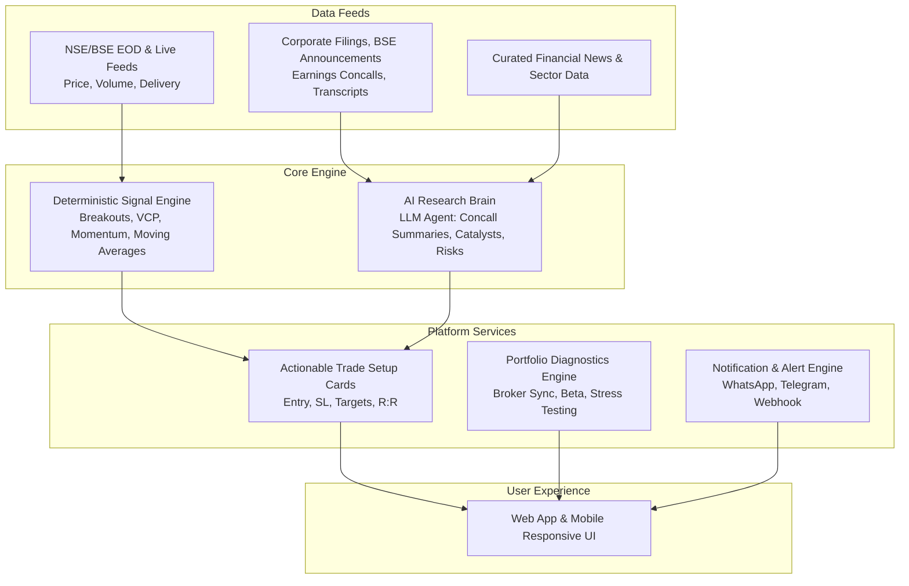

# Business Requirements Document (BRD)
## Next-Gen AI-Powered Swing Screener & Portfolio Intelligence Platform (NSE & BSE)

---

### Document Control
- **Document Version:** 1.0
- **Status:** Draft / Approved Discovery
- **Target Market:** Indian Capital Markets (NSE / BSE Equities)
- **Product Type:** Commercial B2C SaaS Platform

---

## 1. Executive Summary & Vision

### 1.1 Problem Statement
Most Indian stock screeners (e.g., Screener.in, Chartink, TradingView) either provide:
1. Pure raw technical scans with no trade structuring (no stop-loss, no target levels, no risk-reward ratio).
2. Pure fundamental financial ratios without timing or momentum cues.
3. Overwhelming dashboards without contextual qualitative explanations (e.g. *why* is the stock setting up now? What happened in the concall?).
4. Disconnected portfolio tracking where users cannot easily audit whether their current holdings align with active swing setups or are carrying excessive downside/sector risk.

### 1.2 Product Vision
Build an intelligent, non-generic **Swing & Positional Stock Screener & Portfolio Copilot** specifically designed for Indian retail and semi-pro traders. The platform combines:
- **Algorithmic Signal Engine**: Generates high-probability, actionable swing trade setup cards (Entry range, Stop-loss, Multi-tiered targets, R:R).
- **AI Brain (Analyst Copilot)**: Ingests quarterly earnings concalls, exchange filings, sector tailwinds, and news to deliver an unbiased "Second Opinion" qualitative thesis.
- **Dynamic Portfolio Health & Stress Testing**: One-click broker integration (Zerodha, Angel One, Upstox) with real-time portfolio diagnostics, thesis invalidation alerts, and scenario stress testing.

---

## 2. Target Audience & Personas

| Persona | Description | Key Need |
| :--- | :--- | :--- |
| **Retail Swing Trader** | Holds stocks for 3 days to 4 weeks; working professional unable to stare at charts all day. | High-conviction setup cards with pre-calculated entry, stop-loss, and target levels. |
| **Fundamental + Momentum Investor** | Wants strong business earnings growth with technical stage breakouts (Techno-Funda). | AI synthesis of concalls and filings alongside volume/price breakouts. |
| **Active Portfolio Manager** | Manages ₹5L–₹50L+ across 10–25 stocks. | Automated risk audit (sector concentration, portfolio beta, exit alerts). |

---

## 3. High-Level Architecture & System Flow



---

## 4. Functional Requirements

### 4.1 Feature Module 1: Actionable Swing & Positional Screener

#### 4.1.1 Screener Filters & Presets
- Pre-built high-momentum screens:
  - *Volatility Contraction Pattern (VCP) & 52-Week High Breakouts*
  - *High Delivery Volume Accumulation (NSE Delivery % spike + Price consolidation)*
  - *Earnings Surprise Breakouts (EPS acceleration + Fresh technical base)*
  - *Stage 2 Momentum Leaders (Moving Average Ribbon alignment: 20 EMA > 50 SMA > 200 SMA)*
- Custom multi-parameter filtering (Market Cap, Sector, Daily Turnover > ₹5 Cr, RSI ranges, ATR volatility).

#### 4.1.2 Actionable Trade Setup Cards
Every detected opportunity must be rendered as a structured **Setup Card** containing:
- **Symbol & Sector**: E.g., `TRENT (NSE) - Retail`.
- **Setup Type**: E.g., *Cup & Handle Breakout with Delivery Volume Surge*.
- **Entry Zone**: Suggested buy range (e.g., `₹7,200 - ₹7,280`).
- **Invalidation / Stop-Loss**: Hard price level based on swing low or ATR (e.g., `₹6,940 (-3.8%)`).
- **Targets**:
  - Target 1 (1:1.5 R:R) – Partial profit booking level.
  - Target 2 (1:2.5 R:R) – Swing target.
  - Target 3 (Trailing runner) – Dynamic ATR trail.
- **Risk-to-Reward Ratio (R:R)**: Displayed explicitly (minimum 1:2.0 to qualify).
- **Execution Checklist**: 3-point confirmation checklist (e.g., "Nifty above 20 EMA", "Sector outperforming Nifty", "Volume > 1.5x 20DMA").

---

### 4.2 Feature Module 2: The AI "Brain" (Qualitative Analyst Copilot)

#### 4.2.1 Real-Time Second Opinion Engine
For any screened stock, the AI Brain generates an on-demand, executive-level **Investment & Risk Memo**:
- **Earnings & Concall Highlights**:
  - Key management commentary from recent Q-o-Q / Y-o-Y concall transcripts.
  - Capacity expansion (Capex), order book updates, guidance changes.
- **Sector Tailwinds & Catalysts**:
  - Government policy updates (PLI schemes, import duties, budget impacts).
  - Commodity input price trends (raw material cost impacts on margins).
- **Key Risks & Red Flags**:
  - Promoter pledge spikes, related party transactions, auditor remarks.
  - Upcoming risk events (board meetings, result dates, dividend record dates).
- **AI Verdict / Conviction Score**:
  - Summarized as: *Strong Alignment / Neutral / Caution (Technical Setup with Fundamental Headwinds)*.

---

### 4.3 Feature Module 3: Portfolio Analysis & Risk Diagnostics

#### 4.3.1 Ingestion & Synchronization
- **One-Click Broker Sync**: OAuth integration with leading Indian retail brokers:
  - Zerodha Kite Connect
  - Angel One SmartAPI
  - Upstox API
  - Dhan API
- **Fallback Ingestion**: CSV / Excel statement upload with auto-mapping of standard Indian broker export formats.

#### 4.3.2 Portfolio Health Metrics
- **Sector & Market Cap Concentration**:
  - Visual breakdown (warning triggered if single sector exceeds 30% or single stock exceeds 15% of total capital).
- **Portfolio Beta vs Nifty 50**:
  - Measures total portfolio volatility relative to benchmark indices.
- **Current Drawdown & Maximum Risk Exposure**:
  - Total portfolio capital at risk based on active stop-losses.

#### 4.3.3 Rebalancing & Thesis Invalidation Alerts
- Automated alerts when:
  - A held stock closes below its 50-day SMA or key structural support.
  - Severe negative news / corporate governance event surfaces.
  - A stock achieves Target 1 or Target 2 to prompt partial profit lock-in.

#### 4.3.4 What-If Scenario Stress Testing
- Simulation engine calculating estimated portfolio impact under:
  - *Nifty 3% / 5% correction event*
  - *Crude oil surge (+15% shock to paint, tire, airline, chemical stocks)*
  - *RBI interest rate hike cycle*

---

### 4.4 Feature Module 4: Notifications & Multi-Channel Delivery
- Real-time setup triggers and exit warnings delivered via:
  - In-app notification center
  - Telegram Bot alerts
  - WhatsApp notifications (for critical stop-loss triggers)
  - Daily Morning Briefing Email (Pre-market scan of setups before 9:00 AM IST).

---

## 5. Non-Functional & Technical Requirements

| Dimension | Specification |
| :--- | :--- |
| **Market Coverage** | NSE Top 500 (Nifty 500) + Active BSE liquid scrips (Daily turnover > ₹2 Cr). |
| **Data Latency** | End-of-Day (EOD) data updated by 4:00 PM IST; 15-minute delayed or real-time snapshot during market hours (9:15 AM - 3:30 PM IST). |
| **Security & Privacy** | AES-256 encryption for broker access tokens; no storage of trading passwords or PINs. Read-only portfolio permissions. |
| **Scalability** | Cloud-native microservices architecture capable of handling 50,000+ concurrent users with sub-second screener filtering. |
| **Availability** | 99.9% uptime during Indian market trading hours (9:00 AM - 4:00 PM IST). |

---

## 6. Regulatory & Compliance Framework (SEBI Guardrails)

> [!IMPORTANT]
> **SEBI (Research Analyst) Regulations Compliance Strategy**
> - The application operates strictly as an **Algorithmic Analytics & Educational Decision-Support SaaS**, not an automated portfolio management service (PMS) or registered investment advisory (RIA).
> - Every setup card and AI synthesis will prominently feature:
>   - *"Educational & Research Purpose Only. Not SEBI Registered Investment Advice."*
>   - *"Users are responsible for their own capital allocation and risk management."*
> - No automated order execution without explicit manual user confirmation (no autonomous algorithmic trading on user accounts without user discretion).

---

## 7. SaaS Monetization & Pricing Model

```
+-----------------------------------+-----------------------------------+-----------------------------------+
|         FREE / EXPLORER           |           PRO TRADER              |         ELITE / PRO+ AI           |
|            ₹0 / month             |         ₹1,499 / month            |         ₹2,999 / month            |
+-----------------------------------+-----------------------------------+-----------------------------------+
| - End-of-Day basic screens        | - Real-time Setup Cards           | - Everything in Pro Trader        |
| - Top 5 setups daily              | - Full Nifty 500 coverage         | - Unlimited AI Concall Brain      |
| - 1 Manual portfolio (up to 10)   | - Stop-loss & Target alerts       | - What-If Scenario Stress Testing |
| - Delayed data                    | - One-Click Broker Sync           | - Priority WhatsApp/Telegram      |
|                                   | - 15 AI Brain queries/month       | - Custom Scanner Formula Builder  |
+-----------------------------------+-----------------------------------+-----------------------------------+
```

---

## 8. Implementation Roadmap

### Phase 1: MVP Core (Weeks 1 - 6)
- Data pipeline integration (NSE EOD & intraday price/volume).
- Deterministic signal engine with 4 pre-built swing setups (VCP, 52W High, Volume Shock, EMA Ribbon).
- Actionable Trade Setup Card UI with Entry, SL, and Targets.
- Basic manual portfolio tracker.

### Phase 2: AI Brain & Broker Sync (Weeks 7 - 12)
- AI Concall & exchange filing parser for NSE 500 stocks.
- Integration of Zerodha, Angel One, and Upstox OAuth APIs.
- Portfolio Health Audit (Sector concentration & Beta metrics).
- Telegram and Email alert triggers.

### Phase 3: Advanced Portfolio Analytics & Monetization (Weeks 13 - 16)
- What-If Stress Testing engine.
- Subscription billing integration (Razorpay / Stripe India).
- WhatsApp notification gateway.
- Final compliance audit and public beta release.
